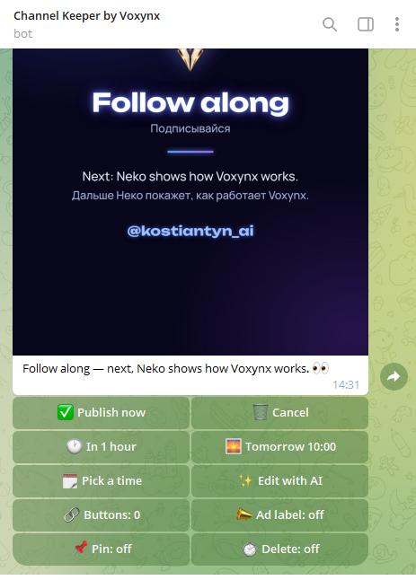
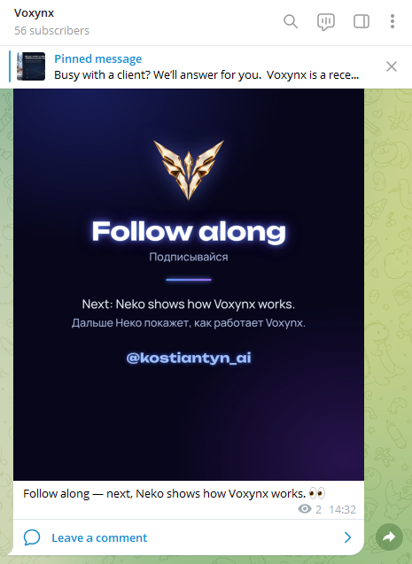
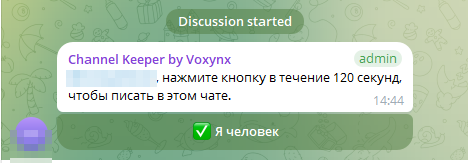
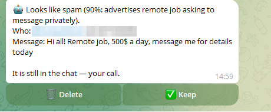
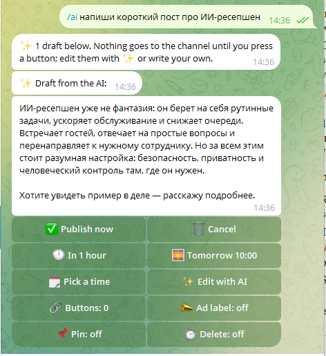
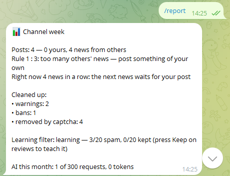
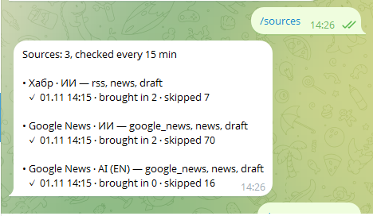
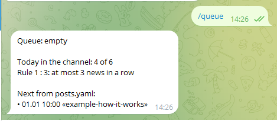

# Channel Keeper by Voxynx

**The bot that keeps your Telegram channel from turning into a dump.**

A free, self-hosted bot for Telegram channel owners. It keeps the discussion group clean, publishes your posts when you want them out, brings in your videos and the news you pick — and keeps the channel balanced between your own posts and other people's news.

[Русская версия](README.ru.md) · Version — [VERSION](VERSION) · [Changelog](CHANGELOG.md) · License — [MIT](LICENSE)

  
  

<i>Send the bot a post → get a preview with buttons → it goes to the channel.</i>

## What it does

**Keeps the comments clean**
- «I'm human» captcha for newcomers — in the comment thread, or in a private chat before they even join (join requests).
- Removes links, ads, spam words and messages sent «on behalf of a channel»; a warning first, then a ban.
- Flood limit, a probation period for newcomers (no picture-only posts, forwards or contacts at first), a profile check for links in bios.
- Doubtful cases come to you with **Delete / Keep** — and a learning filter picks up your decisions. It only ever asks; it never deletes on a guess.

**Publishes**
- Send the bot a post in a private chat — text, photo, video, GIF or album — and get a preview with **Publish now / In 1 hour / Tomorrow / Pick a time**.
- Ad posts: link buttons, an «Advertisement» label, pin for 24 h – 7 days, delete after 24–72 h.
- Plan many posts at once in `posts.yaml`.

**Brings in content**
- Your YouTube videos and blog posts (RSS) — straight to the queue.
- News from Google News, Google Alerts or any RSS — always as a draft you approve first.
- Channel rules: quiet hours, a daily limit, a gap between posts, and «at most 3 news in a row».

**Inbox**
- Messages people write to the channel and posts they suggest (free or for Stars) come to your private chat with **Reply / Approve / Decline**.

**AI — optional, with your own key**
- A second opinion on newcomers' first comments, an editor (`/ai 3 posts from <link>`, **✨ Edit with AI**), and news retold in your channel's words.
- The AI never acts on its own: it never publishes, deletes or bans. A test fails if its code ever gets that access.

Plus: `/report` every Monday, `/log` of everything the bot did, `/forget` to delete a person's data.

Telegram limitation: a bot cannot see the member list or clean up old members. It acts on new messages only.

## Screenshots

| **Captcha in the comment thread** (chat texts here in Russian — set in `keeper.yaml`) | **The AI's second opinion — you decide, nothing is deleted on a guess** |
|---|---|
|  |  |
| **`/ai` — a draft from the AI, never published by itself** | **`/report` — the channel's week** |
|  |  |
| **`/sources` — feeds and their last check** | **`/queue` — what goes out and when** |
|  |  |

## Quick start (about 15 minutes)

1. **Create the bot.** Telegram → **@BotFather** → `/newbot` → a name and a username → copy the **token**. Never share it.
2. **Run it** — pick one way, step by step in [INSTALL](docs/INSTALL.md):
   - **Railway** — no server of your own, everything in the browser;
   - **Docker** — one `docker run`;
   - **your Linux server** — `sudo bash install.sh`.

   Only `BOT_TOKEN` is required. Everything else is chosen in Telegram.
3. **Make the bot an admin** — with these rights only:
   - **Channel:** Post messages.
   - **Discussion group:** Delete messages, Ban users.

   Optional rights and why each one is needed: [PRIVACY](docs/PRIVACY.md#rights--and-only-these).
4. **`/setup`.** Open the bot in a private chat → **Start** → `/setup`. The first person to do it becomes the owner. Pick your channel, then your group — the bot checks its rights and says what is missing.

Then send the bot any text: a preview with **Publish now** comes back. That is your first post.

## Documentation
- [Install: Railway, Docker, your own server](docs/INSTALL.md)
- [Bot commands](docs/COMMANDS.md)
- [Environment variables](docs/CONFIG.md)
- [Channel settings — keeper.yaml](docs/SETTINGS.md) · Russian example: [examples/keeper.ru.yaml](examples/keeper.ru.yaml)
- [Posts](docs/POSTS.md)
- [Feeds and channel rules — sources.yaml](docs/SOURCES.md) · Russian example: [examples/sources.ru.yaml](examples/sources.ru.yaml)
- [Messages to the channel and suggested posts](docs/INBOX.md)
- [Moderation](docs/MODERATION.md)
- [AI (optional, your key)](docs/AI.md)
- [What the bot stores — privacy and rights](docs/PRIVACY.md)

## Updating
1. Download the new release archive (**Releases** on the right).
2. Your repository on GitHub → **Add file → Upload files** → drag in everything from the archive **except** `keeper.yaml`, `sources.yaml` and `posts.yaml` (those are your settings) → **Commit changes**.
3. **Actions** shows a green check; Railway redeploys by itself. `/version` in the bot shows the new version.

The bot's memory (`/setup`, logs, queue) lives on the volume and survives updates.

## Your data
The bot runs on your server or your Railway account and talks only to Telegram, your feeds and — if you add a key — the AI provider you chose. Nothing is sent to the authors. Details: [PRIVACY](docs/PRIVACY.md).

---

Built by [Voxynx](https://voxynx.ai) — an AI receptionist for phone, website chat and messengers. Channel Keeper is free and stays free; it never answers your members on your behalf. Maintained on a best-effort basis; issues and pull requests are welcome.
