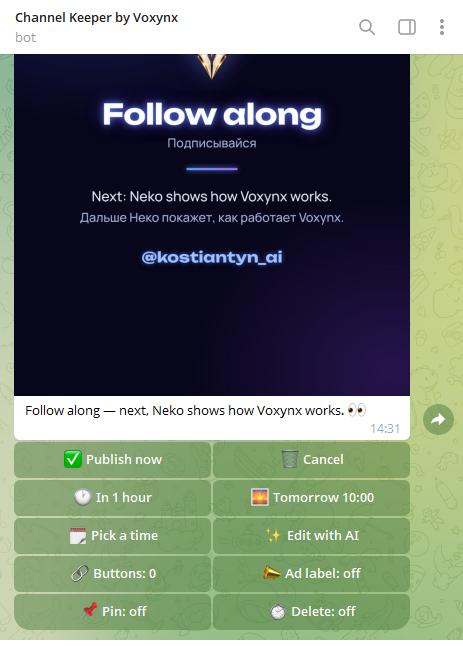
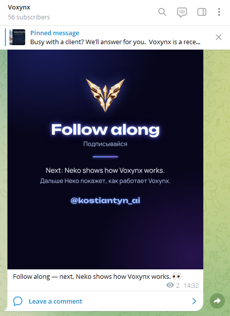
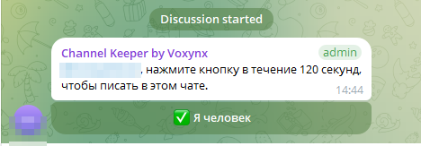
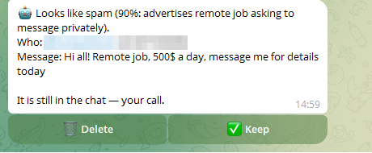
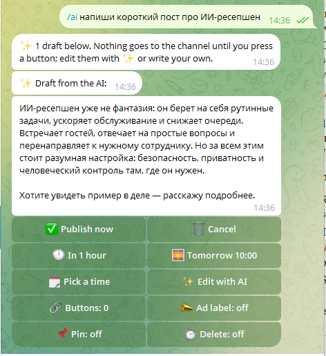
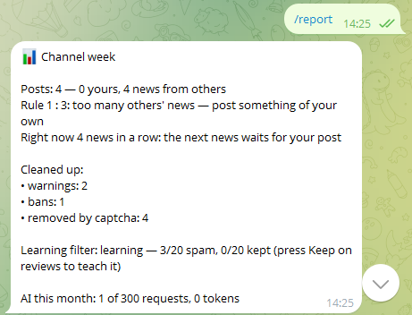
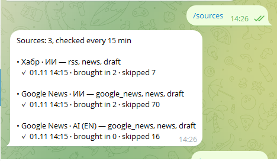
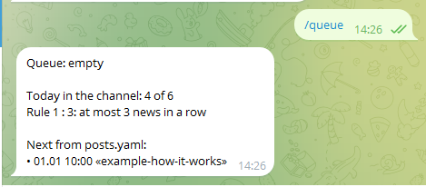

# Channel Keeper by Voxynx

**Бот, который не даёт вашему Telegram-каналу превратиться в помойку.**

Бесплатный бот для владельцев Telegram-каналов, который вы запускаете у себя. Чистит чат комментариев, публикует ваши посты, когда нужно, приносит ваши видео и выбранные вами новости — и держит баланс между своими постами и чужими новостями.

[English](README.md) · Версия — [VERSION](VERSION) · [История изменений](CHANGELOG.md) · Лицензия — [MIT](LICENSE)

Подробная документация в папке `docs/` на английском; установка есть и на русском — [INSTALL.ru.md](docs/INSTALL.ru.md).

  
  

<i>Отправили боту пост → превью с кнопками → пост в канале.</i>

## Что умеет

**Чистит комментарии**
- Капча «Я человек» для новичков — в ветке комментариев или в личке ещё до входа в группу (заявки на вступление).
- Удаляет ссылки, рекламу, стоп-слова и сообщения «от имени канала»; сначала предупреждение, потом бан.
- Антифлуд, испытательный срок для новичков (сначала без картинок без текста, пересылок и контактов), проверка ссылок в профиле.
- Сомнительное приходит вам с кнопками **Удалить / Оставить**, а обучаемый фильтр учится на ваших решениях. Он только спрашивает и никогда не удаляет наугад.

**Публикует**
- Отправьте боту пост в личку — текст, фото, видео, GIF или альбом — и получите превью с кнопками **Сейчас / Через час / Завтра / Выбрать время**.
- Рекламные посты: кнопки-ссылки, пометка «Реклама», закреп на 24 ч – 7 дней, удаление через 24–72 ч.
- Много постов сразу — в файле `posts.yaml`.

**Приносит контент**
- Ваши видео с YouTube и статьи блога (RSS) — сразу в очередь.
- Новости из Google News, Google Alerts или любого RSS — всегда черновиком, сначала одобряете вы.
- Правила канала: тихие часы, лимит в день, интервал между постами и «не больше 3 новостей подряд».

**Входящие**
- Сообщения людей каналу и предложенные посты (бесплатно или за звёзды) приходят вам в личку с кнопками **Ответить / Одобрить / Отклонить**.

**ИИ — по желанию, с вашим ключом**
- Второе мнение о первых комментариях новичков, редактор (`/ai 3 поста по ссылке`, **✨ Править с ИИ**) и пересказ новостей своими словами.
- ИИ никогда не действует сам: не публикует, не удаляет и не банит. Тест падает, если его код получит такой доступ.

А ещё: `/report` каждый понедельник, `/log` — всё, что сделал бот, `/forget` — удалить данные человека.

Ограничение Telegram: бот не видит список участников и не может почистить старых. Он работает только с новыми сообщениями.

## Скриншоты

| **Капча в ветке комментариев** | **Второе мнение ИИ — решаете вы, наугад ничего не удаляется** |
|---|---|
|  |  |
| **`/ai` — черновик от ИИ, сам не публикуется** | **`/report` — неделя канала** |
|  |  |
| **`/sources` — ленты и последняя проверка** | **`/queue` — что и когда выйдет** |
|  |  |

Тексты бота в личке владельца пока на английском; тексты в чате для участников настраиваются в `keeper.yaml`.

## Быстрый старт (около 15 минут)

1. **Создайте бота.** Telegram → **@BotFather** → `/newbot` → имя и username → скопируйте **токен**. Никому его не показывайте.
2. **Запустите** — один из способов, по шагам в [INSTALL.ru.md](docs/INSTALL.ru.md):
   - **Railway** — без своего сервера, всё в браузере;
   - **Docker** — одна команда `docker run`;
   - **свой Linux-сервер** — `sudo bash install.sh`.

   Обязателен только `BOT_TOKEN`. Всё остальное выбирается в Telegram.
3. **Сделайте бота админом** — только с этими правами:
   - **Канал:** публикация сообщений.
   - **Группа обсуждения:** удаление сообщений, блокировка пользователей.

   Дополнительные права и зачем каждое: [INSTALL.ru.md](docs/INSTALL.ru.md#после-любого-способа-права-setup-команды).
4. **`/setup`.** Откройте бота в личке → **Start** → `/setup`. Кто сделал это первым, становится владельцем. Выберите канал, потом группу — бот проверит свои права и скажет, чего не хватает.

Потом отправьте боту любой текст: придёт превью с кнопкой **Опубликовать сейчас**. Это ваш первый пост.

## Для русскоязычного канала
Скопируйте `examples/keeper.ru.yaml` в `keeper.yaml` (тексты бота в чате, пометка «Реклама», язык пересказов) и, если нужно, `examples/sources.ru.yaml` в `sources.yaml` (пример лент на русском).

## Обновление
1. Скачайте архив нового релиза (**Releases** справа).
2. Ваш репозиторий на GitHub → **Add file → Upload files** → перетащите всё из архива, **кроме** `keeper.yaml`, `sources.yaml` и `posts.yaml` (это ваши настройки) → **Commit changes**.
3. В **Actions** зелёная галочка, Railway пересоберёт бота сам. `/version` покажет новую версию.

Память бота (`/setup`, журнал, очередь) хранится на томе и переживает обновления.

## Ваши данные
Бот работает на вашем сервере или в вашем аккаунте Railway и общается только с Telegram, вашими лентами и — если добавите ключ — с выбранным провайдером ИИ. Авторам ничего не отправляется. Подробно: [PRIVACY](docs/PRIVACY.md).

---

Сделано в [Voxynx](https://voxynx.ai) — ИИ-администратор для звонков, чата на сайте и мессенджеров. Channel Keeper бесплатный и останется бесплатным; он никогда не отвечает вашим подписчикам от вашего имени. Поддерживается по мере сил; issues и pull requests приветствуются.
